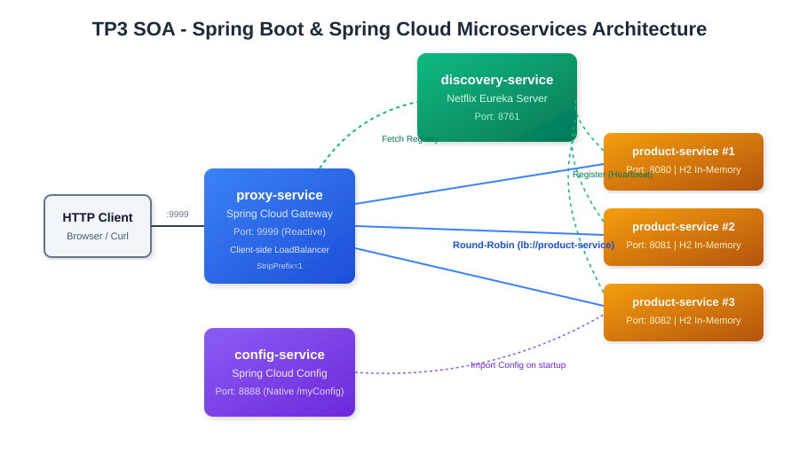

# TP3 - Microservices avec Spring Boot et Spring Cloud

Implementation of the ISETJB SOA lab (TP3): four independently deployable
Spring Boot services communicating through Spring Cloud (configuration, discovery, routing / load balancing).

> **Status:** **Completed & Verified** (Phases 0 to 6 completed).  
> Detailed architecture, screenshots, and demonstration logs are available in [docs/report.md](docs/report.md).  
> Tracking roadmap: [ROADMAP.md](ROADMAP.md).

---

## Architecture



```text
                        +---------------------+
   Browser / Client --> |   Proxy Service     |   :9999
                        |  Spring Cloud       |
                        |  Gateway + LB       |
                        +----------+----------+
                                   |  lb://product-service
                                   v
                        +---------------------+
                        |  Discovery Service  |   :8761   (Eureka registry)
                        +----------+----------+
                                   ^ register / discover
                                   |
             +---------------------+---------------------+
             |                     |                     |
      +------+------+       +------+------+       +------+------+
      | Product     |       | Product     |       | Product     |
      | Service #1  |       | Service #2  |       | Service #3  |
      |  :8080      |       |  :8081      |       |  :8082      |
      +-------------+       +-------------+       +-------------+

                        +---------------------+
                        |  Config Service     |   :8888
                        |  (myConfig repo)    |  <- all services read their
                        +---------------------+     properties from here
```

---

## Services & Tech Stack

| Service | Port(s) | Spring Stack | Role |
| :--- | :--- | :--- | :--- |
| **`config-service`** | `8888` | Spring Cloud Config Server (`native` profile) | Centralized configuration source (`myConfig/` directory) |
| **`discovery-service`**| `8761` | Netflix Eureka Server | Dynamic service registry |
| **`product-service`** | `8080`, `8081`, `8082` | Spring Web, Spring Data JPA, H2, Actuator, Eureka Discovery, Config Client | CRUD API (`/produits`), H2 DB, `/messages` endpoint |
| **`proxy-service`** | `9999` | Spring Cloud Gateway (Reactive WebFlux), LoadBalancer, Eureka Client | API Gateway, route `/product-service/**` to `lb://product-service` with `StripPrefix=1` |

---

## How to Build and Run

### 1. Build All Modules
From the repository root:
```bash
./mvnw clean package -DskipTests
```
*(On Windows: `.\mvnw.cmd clean package -DskipTests`)*

### 2. Execution Order
Start each service in a separate terminal:

```bash
# 1. Config Service (port 8888)
java -jar config-service/target/config-service-1.0.0-SNAPSHOT.jar

# 2. Discovery Service (port 8761)
java -jar discovery-service/target/discovery-service-1.0.0-SNAPSHOT.jar

# 3. Product Service Instances (8080, 8081, 8082)
java -jar product-service/target/product-service-1.0.0-SNAPSHOT.jar --server.port=8080
java -jar product-service/target/product-service-1.0.0-SNAPSHOT.jar --server.port=8081
java -jar product-service/target/product-service-1.0.0-SNAPSHOT.jar --server.port=8082

# 4. Proxy Service / Gateway (port 9999)
java -jar proxy-service/target/proxy-service-1.0.0-SNAPSHOT.jar
```

---

## Demonstration URLs

- **Eureka Registry Web Dashboard:** [http://localhost:8761](http://localhost:8761)
- **Config Server Endpoint:** [http://localhost:8888/product-service/master](http://localhost:8888/product-service/master)
- **Direct Product Service (CRUD):** [http://localhost:8080/produits](http://localhost:8080/produits)
- **H2 Web Console:** [http://localhost:8080/h2-console](http://localhost:8080/h2-console) (JDBC URL: `jdbc:h2:mem:testdb`, User: `sa`, blank password)
- **Gateway Load-Balanced Messages (Round-Robin):** [http://localhost:9999/product-service/messages](http://localhost:9999/product-service/messages)
- **Gateway Load-Balanced Products:** [http://localhost:9999/product-service/produits](http://localhost:9999/product-service/produits)
- **Actuator Health & Metrics:** [http://localhost:8080/actuator/health](http://localhost:8080/actuator/health), [http://localhost:8080/actuator/metrics](http://localhost:8080/actuator/metrics)
