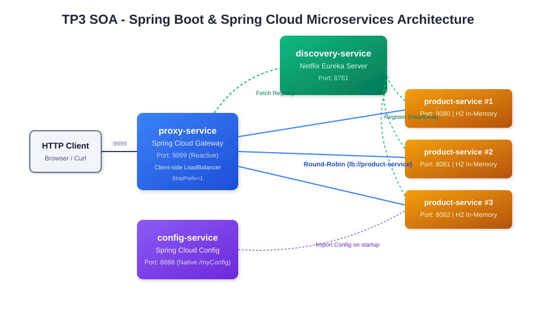
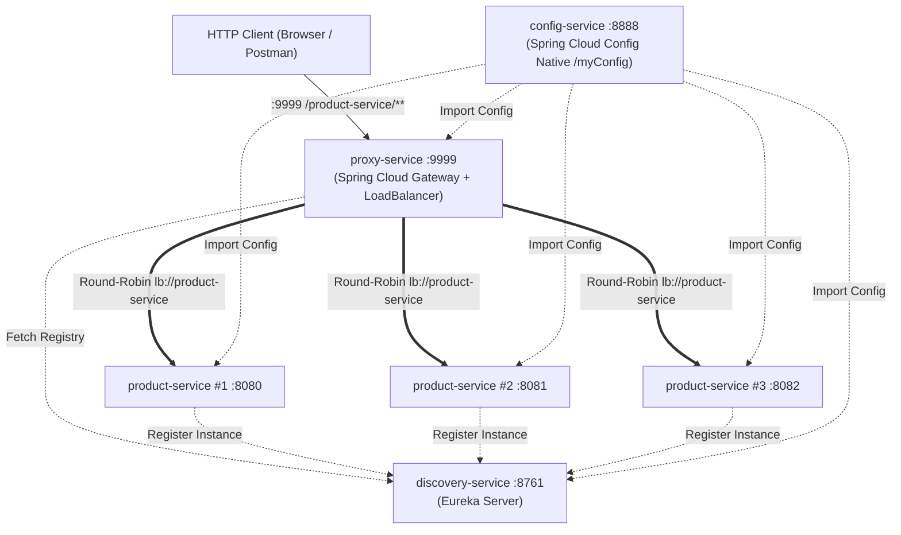
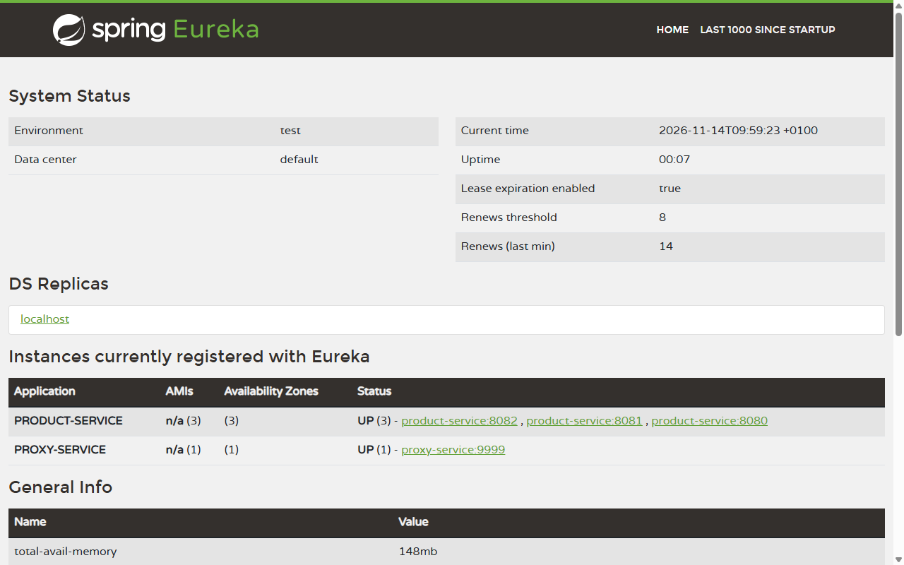
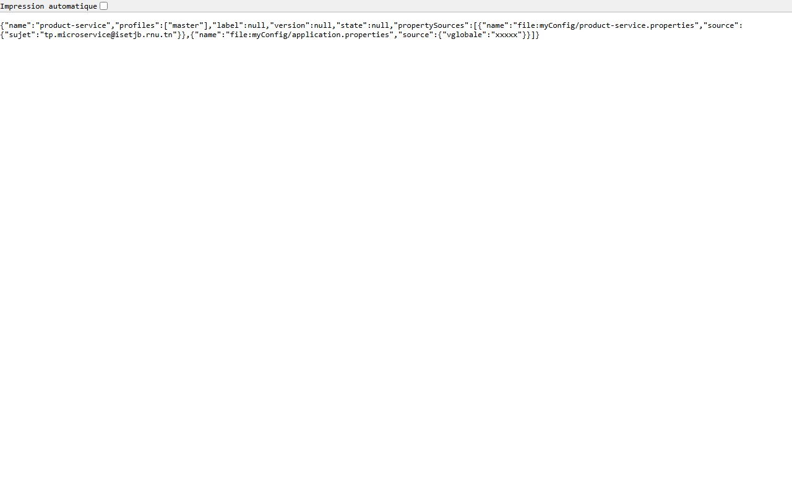
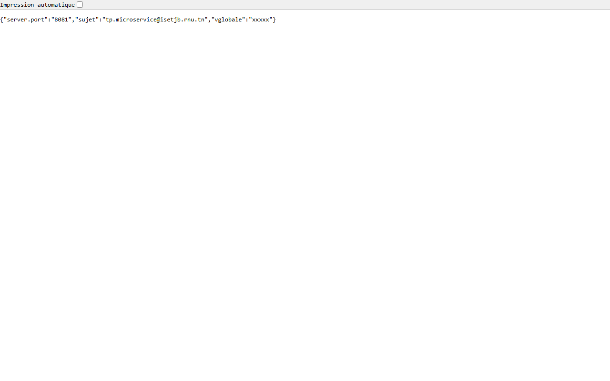
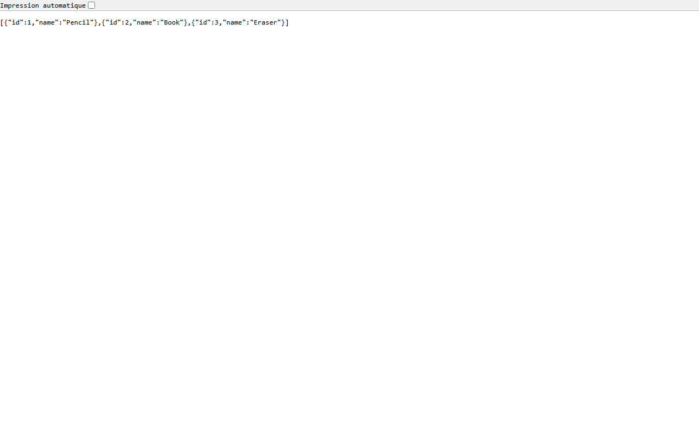

# TP3 SOA - Microservices Architecture & Demonstration Report

## 1. Architecture Diagram

---

## 2. Spring Cloud LoadBalancer & Caching Notes (Phase 5)

- **Default Cache:** `Spring Cloud LoadBalancer` caches instance lists retrieved from Eureka in memory.
- **Failover / Propagation latency:**
  - Eureka clients refresh their local instance cache periodically governed by `eureka.client.registry-fetch-interval-seconds` (default: 30 seconds).
  - When an instance is stopped or dies, there is a small propagation window (~30s) during which the gateway cache may still route to the terminated instance until the next registry sync evicts it.
  - Setting `eureka.client.registry-fetch-interval-seconds=5` in development speeds up failover detection.

---

## 3. Demonstration Screenshots (Phase 6)

### 3.1 Eureka Service Registry Dashboard (`http://localhost:8761`)
Shows `PRODUCT-SERVICE` with all 3 instances (`8080`, `8081`, `8082`) registered:

### 3.2 Centralized Config Server (`http://localhost:8888/product-service/master`)
Shows merged configuration (`vglobale=xxxxx` + `sujet=tp.microservice@isetjb.rnu.tn`):

### 3.3 Microservice `/messages` on each instance
- **Port 8080:**
  
- **Port 8081:**
  
- **Port 8082:**
  

### 3.4 API Gateway Load Balancing & Routing (`http://localhost:9999`)
- **Messages endpoint load-balanced (`/product-service/messages`):**
  

- **Products endpoint routed (`/product-service/produits`):**
  
